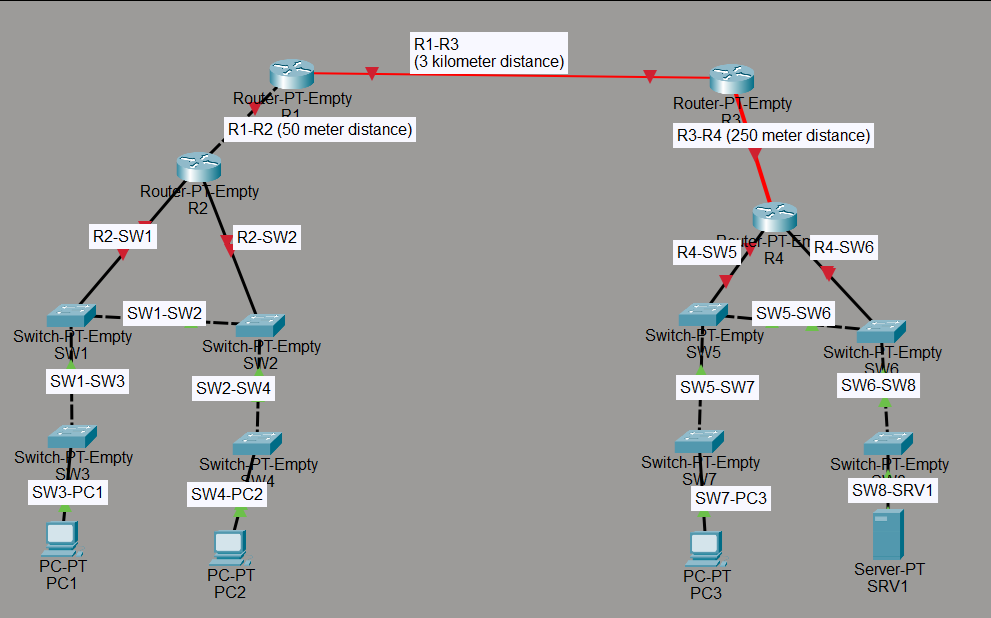

# LAB 02: Interfaces and Cables

Network topology built and simulated in Cisco Packet Tracer as part of the Network Fundamentals module.

## Engineering Decisions and Architectural Notes

1. **End Devices to Switches (Straight-Through):**
   I started by identifying that PCs, servers, and routers need to be connected to switches using UTP copper straight-through cables. These are used to connect devices with complementary pinouts—for example, PCs, servers, and routers transmit data on pins 1 & 2 and receive on pins 3 & 6, while switches do the exact opposite.

2. **Switch-to-Switch Connections (Crossover):**
   My next step was connecting devices of the same type (switches). Assuming Auto-MDI/MDI-X is disabled, I had to use crossover cables so that identical transmit/receive pins wouldn't talk directly to each other, which would prevent data exchange.

3. **Switches to Routers (Hardware & Cost Constraints):**
   I connected the switches to the routers using the same UTP straight-through cables. Using fiber optics here would be engineering overkill—the routers and switches are close to each other, making copper much more cost-effective. Additionally, the routers' fiber ports (SFP) needed to be reserved for long-distance router-to-router links, and the switches didn't have any SFP slots available anyway.

4. **Router-to-Router Links: R1–R2 (50m) & R3–R4 (250m):**
   * **R1 to R2 (50m):** Connected using a **copper crossover cable**. Since both routers transmit on pins 1 & 2 and receive on pins 3 & 6, a crossover cable is required to cross the Tx/Rx pairs (Auto-MDI/MDI-X disabled). The 50-meter distance is well within the 100-meter maximum limit for standard UTP copper cabling, making it the most cost-effective solution.
   * **R3 to R4 (250m):** A UTP copper crossover cable could not be used here because the 250-meter distance exceeds the 100-meter physical limit for copper (which would cause severe signal attenuation). Instead, I used **Multimode Fiber (MMF)**, as it easily supports distances up to 550 meters while keeping transceiver costs significantly lower than Single-Mode Fiber.

5. **Long-Range Router-to-Router Link: R1–R3 (3 km):**
   For the 3-kilometer connection between R1 and R3, both copper UTP (max 100m) and Multimode Fiber (max ~550m) were out of the question due to distance limitations and modal dispersion. Therefore, I used **Single-Mode Fiber (SMF)**, which is designed for long-distance transmission spanning several kilometers.

   *Based on CCNA curriculum (Jeremy's IT lab)*